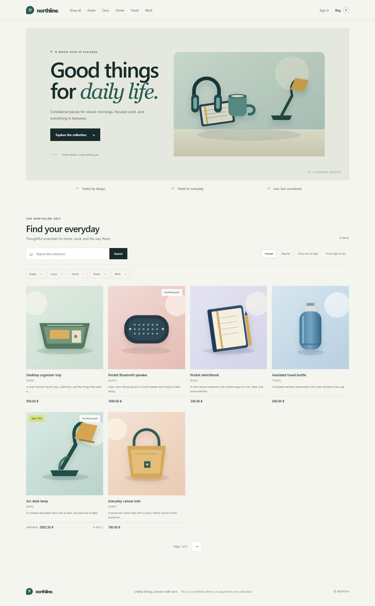

# Northline — Django Storefront

Northline is a small Django storefront prototype for considered everyday goods. It demonstrates a multi-app Django project with a searchable catalog, categories, discounts, a session-based shopping bag, promo codes, product reviews, and customer accounts.

The original application had a working feature base but very little product identity, uneven page styling, and no project documentation. The storefront is now English-first, responsive, and built around original synthetic catalog artwork. This is a portfolio and learning project, not a production commerce system.

## Preview



See the [full screenshot gallery](docs/SCREENSHOTS.md) for the product detail and review view, a bag with a working demo promotion, and an account profile.

## Features

- Browse active products by category, search text, and sort order.
- View product details, discounts, rating summaries, and customer reviews.
- Add items to a session-based bag, change quantities, and remove items.
- Apply the seeded `WELCOME10` promotion to the bag total.
- Register, sign in, and view an account profile.
- Manage catalog records, discounts, reviews, and accounts through Django Admin.
- Load a repeatable English sample catalog with `python manage.py seed_demo`.

## Quick start

Use Python 3.13 and PowerShell on Windows:

```powershell
py -3.13 -m venv .venv
.\.venv\Scripts\Activate.ps1
python -m pip install --upgrade pip
pip install -r requirements.txt

# Keep your local database separate from the repository's starter database.
$env:DJANGO_DB_PATH = Join-Path (Get-Location) 'local.sqlite3'
$env:DJANGO_MEDIA_ROOT = Join-Path (Get-Location) 'media'
python manage.py migrate
python manage.py seed_demo
python manage.py runserver
```

Open [http://127.0.0.1:8000](http://127.0.0.1:8000). Create an account in the storefront to try account features. The seed command creates review authors with unusable passwords, so those sample accounts are only for displaying synthetic reviews.

For Linux or macOS, create and activate a virtual environment with your preferred Python 3.13 command, then install the requirements and run:

```bash
export DJANGO_DB_PATH="$PWD/local.sqlite3"
export DJANGO_MEDIA_ROOT="$PWD/media"
python manage.py migrate
python manage.py seed_demo
python manage.py runserver
```

More setup details and configuration are in [Development setup](docs/DEVELOPMENT.md).

## Demo limitations

- There is no checkout flow from the shopping bag, payment provider, shipping service, inventory reservation, or order email. The bag page says this explicitly.
- A separate legacy single-product demo-order route can record a sample order for a signed-in user. It does not collect payment or represent a real purchase.
- The project is configured for local development with SQLite and Django’s static-file development server. Configure production settings and infrastructure before deployment.
- The sample catalog uses original synthetic SVG illustrations and invented product copy. It is not a real shop catalog.

See [Project assessment](docs/PROJECT_ASSESSMENT.md) for an honest scope and next steps, and [Architecture](docs/ARCHITECTURE.md) for the app and data model overview.
