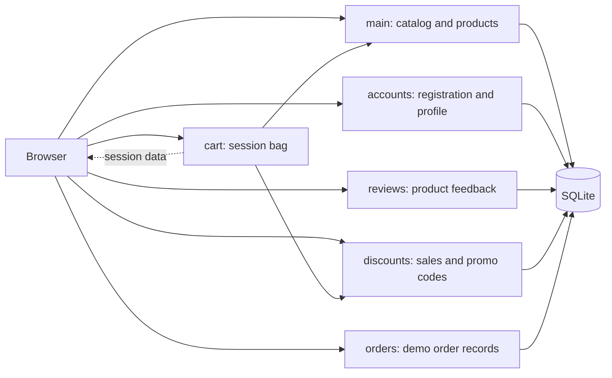
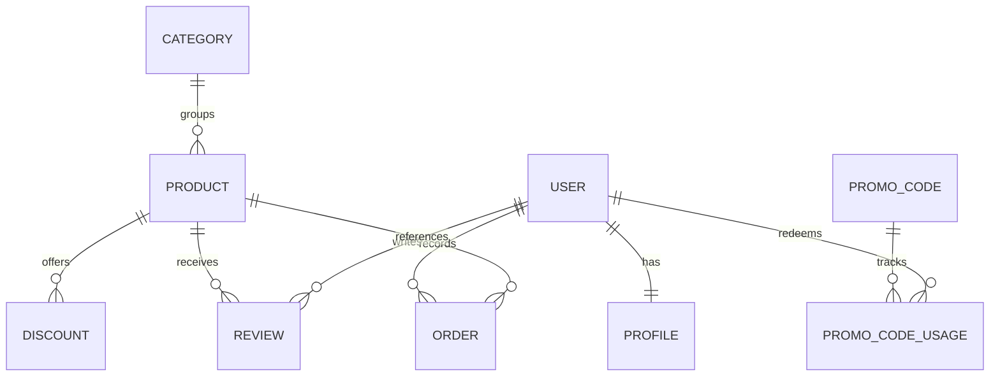

# Architecture overview

## Application map

The application is server-rendered with Django templates and one responsive CSS file. The cart and promo code are stored in the browser’s Django session. Product, category, review, profile, discount, promo code, and demo order records use Django models.

## Django apps

| App         | Responsibility                                                                                                  |
| ----------- | --------------------------------------------------------------------------------------------------------------- |
| `main`      | Catalog filtering, search, sorting, product details, categories, and catalog administration                     |
| `cart`      | Session-backed product quantities, totals, and bag pages                                                        |
| `discounts` | Product discounts, promo code validation, and promo usage records                                               |
| `accounts`  | Django user registration, login, logout, and profile data                                                       |
| `reviews`   | One review per user and product, ratings, review moderation, and helpful counts                                 |
| `orders`    | A small legacy single-product demo-order record flow; it is not connected to payment processing or bag checkout |

## Main data relationships

The cart itself is not a database model. Each session stores a product ID, quantity, and unit price. A promo code is validated against the current bag total when applied and recalculated when the bag summary is rendered.

## Important routes

| URL                                              | Purpose                                           |
| ------------------------------------------------ | ------------------------------------------------- |
| `/`                                              | Catalog and search                                |
| `/category/<slug>/`                              | Category-filtered catalog                         |
| `/product/<id>/<slug>/`                          | Product detail, rating summary, and reviews       |
| `/cart/`                                         | Current session bag and promo code                |
| `/register/`, `/login/`, `/logout/`, `/profile/` | Customer account pages                            |
| `/admin/`                                        | Django Admin for staff users                      |
| `/discounts/product/<product-id>/`               | Current offers for a product                      |
| `/discounts/promo/`                              | Staff promo-code list and usage reports           |
| `/orders/buy/<product-id>/`                      | Legacy demo-only single-product order record flow |

## Asset choices

The public preview catalog uses original SVG product illustrations under `media/demo/products/` and a matching hero illustration under `static/images/`. This avoids presenting the repository’s mixed legacy uploads as a coherent real catalog. Other media paths are reserved for site uploads.
