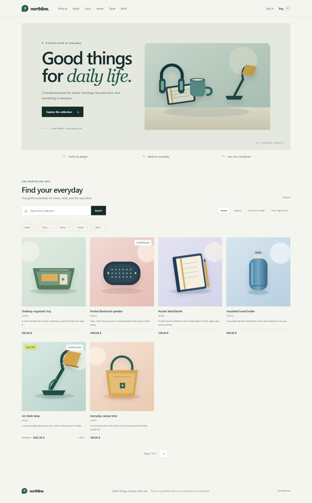
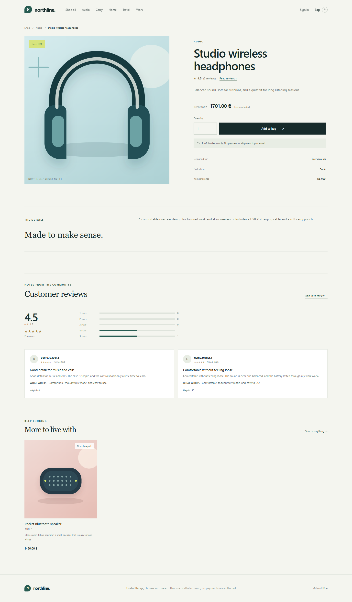
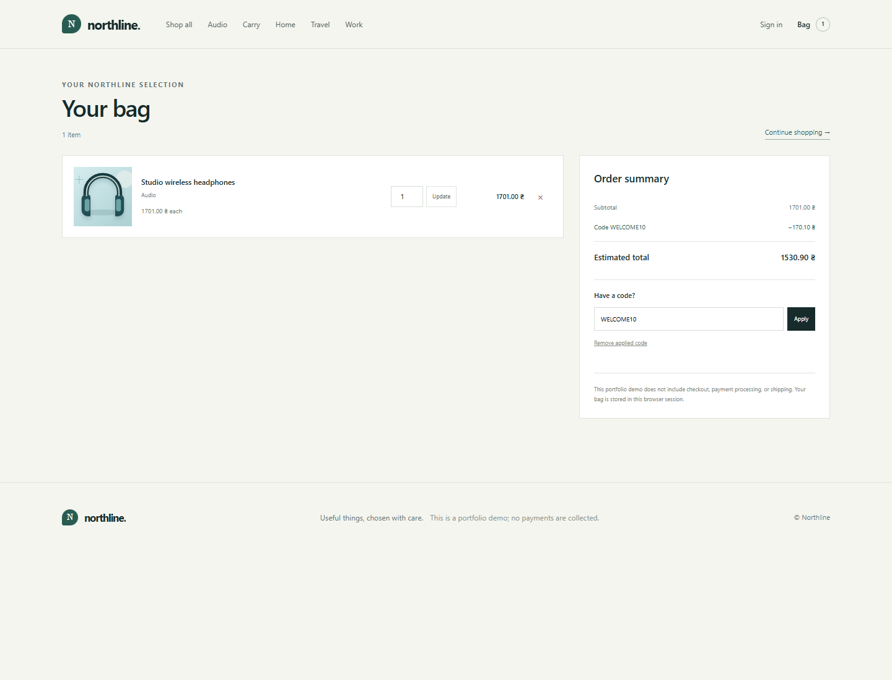
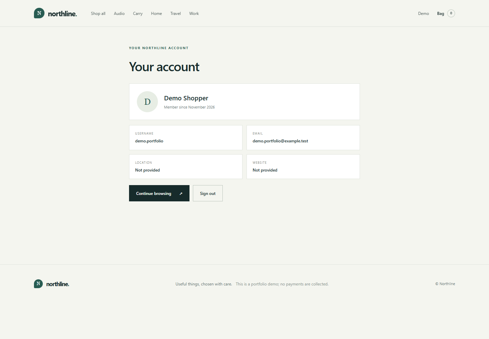

# Screenshot gallery

These desktop screenshots were captured from the local Django app after loading `seed_demo`. Product art, review text, profile details, and account names shown here are synthetic. The storefront and portfolio documentation are in English.

## Catalog

The catalog shows the home hero, category links, search and sort controls, six products per page, the featured label, and a sale price.

## Product detail and reviews

The detail view demonstrates a sale price, review summary and rating distribution, product details, and synthetic customer feedback.

## Shopping bag and promo code

`WELCOME10` applies a 10% demo discount to the bag total. The page makes clear that the project does not collect payment or arrange shipping.

## Account profile

This page was captured with a synthetic portfolio account created locally for the screenshot. It is not a seeded login or a real customer account.
